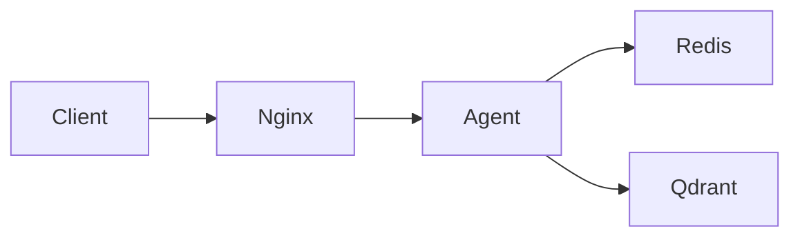

# MISSION_ANSWERS — Day 14

## Part 1 — Localhost vs Production

### Exercise 1.1 — Các anti-pattern

Các số dòng dưới đây thuộc `01-localhost-vs-production/develop/app.py`.

1. **Hardcode thông tin xác thực (dòng 17–18).** Nếu dùng cách này với thông tin thật, người có quyền đọc mã nguồn hoặc lịch sử Git có thể lấy được thông tin xác thực.
2. **Ghi khóa và nội dung request vào log (dòng 33–38).** Log thường được lưu và chia sẻ để chẩn đoán lỗi. In dữ liệu thô có thể làm lộ khóa hoặc nội dung người dùng gửi.
3. **Bật reload cố định (dòng 53).** Chế độ theo dõi thay đổi mã phù hợp khi phát triển. Khi triển khai, việc khởi động lại do tệp thay đổi có thể làm gián đoạn phục vụ.
4. **Cổng cố định (dòng 52).** Nếu nền tảng cấp cổng khác qua biến `PORT`, agent sẽ lắng nghe sai cổng.
5. **Chỉ lắng nghe trên localhost (dòng 51).** Trong container, dịch vụ khác hoặc cổng được publish cần agent lắng nghe trên giao diện mạng của container.
6. **Thiếu endpoint kiểm tra trạng thái (dòng 42–43).** Công cụ triển khai thiếu tín hiệu riêng để kiểm tra tiến trình còn sống hay agent đã sẵn sàng nhận request.
7. **Thiếu hook dọn tài nguyên của ứng dụng khi tắt (dòng 46–54).** Nếu sau này agent có kết nối cơ sở dữ liệu hoặc hàng đợi, ứng dụng cần một đoạn lifecycle để đóng chúng khi shutdown.

### Exercise 1.2 — Chạy bản develop

Chạy Uvicorn từ `01-localhost-vs-production/develop` trên cổng 18014 để kiểm tra bản develop riêng với các dịch vụ có thể đang dùng cổng 8000.

```powershell
python -X utf8 -m uvicorn app:app --host 127.0.0.1 --port 18014
# Chạy lệnh dưới đây ở một cửa sổ PowerShell khác
curl.exe -i -X POST 'http://127.0.0.1:18014/ask?question=Hello'
```

Kết quả thực tế:

```text
HTTP/1.1 200 OK
content-type: application/json

{"answer":"Đây là câu trả lời từ AI agent (mock). Trong production, đây sẽ là response từ OpenAI/Anthropic."}
```

`question` được truyền qua query string vì handler bản develop khai báo `question: str` trực tiếp. Lần thử đầu trong phiên kiểm tra trả 500 do stdout dùng CP1252 và không in được tiếng Việt. Bật UTF-8 bằng `-X utf8` rồi gọi lại thành công.

### Exercise 1.3 — So sánh develop và production

| Tính năng | Develop | Production | Vì sao quan trọng? |
| --- | --- | --- | --- |
| Cấu hình | Giá trị cố định trong `app.py:17–22`. | Đọc qua `settings` từ `config.py` và truyền `settings.host`, `settings.port` vào Uvicorn (`app.py:24, 192–199`). | Có thể thay cấu hình giữa local và môi trường triển khai mà không sửa mã nguồn. |
| Health check | Chỉ có route gốc và route hỏi đáp. | `GET /health` cho biết tiến trình đang phản hồi. `GET /ready` trả 503 khi cờ sẵn sàng tắt (`app.py:135–161`). | Công cụ giám sát có thể phân biệt tiến trình còn sống với khả năng nhận traffic. |
| Logging | Dùng `print()` và in cả khóa (`app.py:33–38`). | Dùng logger có trường thời gian, cấp độ, thông điệp. Sự kiện gọi agent ghi độ dài câu hỏi và câu trả lời (`app.py:27–32, 110–122`). | Log có cấu trúc dễ lọc khi chẩn đoán lỗi và giảm nguy cơ để lộ khóa. |
| Shutdown | Chưa có hook shutdown riêng của ứng dụng. | `lifespan` hạ cờ sẵn sàng và ghi log khi shutdown (`app.py:39–74`). Uvicorn quản lý việc chờ request đang xử lý. | Hook lifecycle là nơi để dọn tài nguyên sau khi ngừng nhận công việc mới. Bản mẫu mô phỏng bước dọn tài nguyên. |

## Part 2 — Docker

1. Base image của bản develop là `python:3.11`, cung cấp runtime và thư viện hệ thống để chạy Python.
2. `WORKDIR /app` đặt thư mục làm việc cho các lệnh còn lại và lúc container khởi động.
3. Dockerfile copy và cài `requirements.txt` trước khi copy mã. Khi chỉ sửa file Python, Docker có thể tái sử dụng layer cài thư viện.
4. `EXPOSE 8000` mô tả cổng ứng dụng. `CMD` khởi động agent và `docker run -p` ánh xạ cổng container ra máy chủ.

Docker báo `agent-develop:lab14` là **1,67 GB** và `agent-production:lab14` là **240 MB**, tức giảm khoảng **85,6%** theo số đã làm tròn. Bản production dùng image slim và copy các thư viện đã cài từ builder sang runtime. Công cụ build chỉ nằm trong builder.



Bản develop trong container trả HTTP 200 khi gọi `POST /ask?question=Hello`. Compose đánh dấu Redis, Qdrant, agent và Nginx đều healthy. Gọi `GET http://127.0.0.1/health` qua Nginx nhận JSON có `status: ok`, `version: 2.0.0`.

## Part 3 — Cloud Deployment

Railway dùng `railway.toml` để chọn Dockerfile và health check. Render Blueprint dùng YAML để khai báo service và nguồn biến môi trường. Trong ví dụ Cloud Run, pipeline Cloud Build tạo image, đẩy image lên registry, rồi khai báo service chạy image đó với tài nguyên và biến môi trường tương ứng.

Xem [DEPLOYMENT.md](DEPLOYMENT.md) để biết cấu hình của agent Part 6 và trạng thái URL public.

## Part 4 — API Security

Kiểm tra hai ứng dụng mẫu bằng FastAPI TestClient với body JSON. Giữ JWT trong biến trong lúc test.

| Trường hợp | Kết quả quan sát |
| --- | --- |
| `POST /ask` bản develop, thiếu API key | 401 |
| `POST /ask` bản develop, có API key hợp lệ | 200 |
| `POST /auth/token` bản production, tài khoản demo | 200 |
| `POST /ask` bản production, lần gọi đầu với JWT hợp lệ | 200 |
| Cùng JWT, lần gọi thứ 11 liên tiếp | 429, `Retry-After: 59` |

Rate limiter giới hạn số request trong một cửa sổ thời gian. Cost guard kiểm tra ngân sách trước khi gọi mô hình, rồi cộng chi phí theo input và output token. Hai giới hạn xử lý hai trường hợp khác nhau, vì một ít request dài vẫn có thể tốn nhiều tiền.

## Part 5 — Scaling & Reliability

- `/health` kiểm tra tiến trình còn phản hồi, còn `/ready` kiểm tra điều kiện nhận traffic như kết nối Redis. Load balancer có thể tạm loại instance chưa sẵn sàng.
- Khi nhận SIGTERM, server ngừng nhận kết nối mới và chờ request còn chạy rồi mới dọn tài nguyên trong lifecycle. Điều này giảm lỗi khi thay container.
- Lịch sử phiên dùng chung trong Redis. Với Nginx phân phối request sang các instance, session vẫn được đọc lại từ Redis dù request sau sang instance khác.
- Chạy stack scaling với ba instance ở cổng 18085. `test_stateless.py` quan sát 5 request qua cả 3 instance và tìm đủ 10 message trong lịch sử phiên.

## Part 6 — Production readiness

`python -X utf8 check_production_ready.py` trên Windows trả **11/12 tiêu chí, 40/40 bước đã chạy đạt**. Image 273 MB. `docker stop` hoàn tất sau 0,6 giây, exit code 0. Windows bỏ qua bài SIGTERM lúc có request đang chạy.

Khi chạy riêng bài runtime trong container Linux với Redis, request đang xử lý trả **HTTP 200** sau khi gửi SIGTERM và tiến trình thoát với code 0. Lần chạy Linux dùng `--skip-docker` và chỉ mount thư mục Part 6, vì vậy không dùng kết quả đó làm điểm tổng chính thức.

## AI log

- **CP1:** Yêu cầu Codex làm CP1. Codex đối chiếu hai bản `app.py`, soạn phần trả lời và chạy thử HTTP trên máy. Codex xác nhận bản develop trả 200 với `question=Hello` sau khi bật UTF-8. Bảng production dựa trên đọc mã nguồn. Phần tự chạy lại và diễn giải bằng lời của học viên chưa được ghi nhận.
- **CP2–CP8:** Yêu cầu Codex hoàn thiện project và push Git. Codex triển khai agent Part 6, sửa cấu hình Docker của các stack mẫu, chạy các kiểm tra local và ghi báo cáo từ output thực tế. Codex bổ sung hai mục kiến thức cho eval và chạy lại trên bộ dữ liệu có sẵn. Phần tự chạy lại và giải thích kết quả của học viên chưa được ghi nhận.
